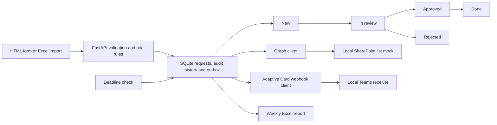

# Process automation toolkit

A small request-process lab in Python 3.11, FastAPI, SQLite and SQLAlchemy. A requester asks for a tool, material or software license. The app validates it, records changes, enforces review and approval roles, syncs to a Graph-shaped list, sends Adaptive Card messages, checks approval deadlines and creates a weekly Excel report.

Everything for this task runs in GitHub Actions. The workflow starts the app and both local mock servers, drives the process over HTTP and through the browser, imports an Excel file, generates the report and uploads artifacts. No PC installs, local Docker, Microsoft account, API key or hosting are needed. All people, requests and imported data are synthetic.

## Flow



## Three commands to run it

CI installs the package automatically with `python -m pip install -e '.[test,ci]'`. The following commands show the three processes in an already prepared Python environment. Each server uses its own process. They are reference commands; the user does not need to run them.

```sh
process-toolkit serve --service mock-graph --port 8011
process-toolkit serve --service mock-teams --port 8012
process-toolkit serve --service app --port 8000
```

The page is at `http://127.0.0.1:8000`. All servers bind to loopback. `python ci/e2e.py` starts and stops all three automatically and runs the CI scenario. Full command examples for reporting, import, reminders and retries are in the [user guide](docs/user-guide.md).

## Request rules and audit

The form accepts title, category, department, quantity, cost, justification and an aware UTC approval deadline. Categories are tool, material and software_license. Departments are Production, Engineering, Office and IT. Quantity is an integer from 1 to 1000. Estimated cost is EUR 0 to 100000, in cents. Deadlines must be from one minute to 30 days ahead. Unknown fields and invalid values return 422.

The flow is `new -> in_review -> approved -> done` or `new -> in_review -> rejected`. Nolan, the synthetic approver, starts review and makes the decision. Rejection needs an explanation. The owning requester confirms done. Done and rejected are terminal. Only an owning requester can edit a new request. Each write requires a version, and a stale version returns 409.

Every creation, edit and status change appends an audit entry with actor, UTC timestamp, old and new state, comment and full snapshot. The request update, history and outbox events commit in one database transaction. Earlier snapshots remain intact. Requesters see their own records; approvers can see the whole lab list.

`X-Lab-User` selects mira, sola or nolan. The server maps that identity to a fixed role. A client cannot submit a requester id or role in a request body. This is a role demonstration with no authentication. Anyone with access to the local lab can choose a synthetic identity. It is not a production access-control or login system.

## Mock SharePoint and Graph client

The mock implements a single list at `/v1.0/sites/lab/lists/requests/items`:

| Operation | Shape |
| --- | --- |
| Create item | `POST .../items` with a `fields` object; returns id, fields and eTag |
| Read collection | `GET .../items?$expand=fields` with a `value` array |
| Read one item | `GET .../items/{id}` |
| Update columns | `PATCH .../items/{id}/fields`; partial fields are retained |
| Filter | `$filter=fields/Status eq 'new'`, with a documented equality subset |
| Page | `$top` and `$skiptoken`, with an absolute `@odata.nextLink` |
| Concurrency | Optional `If-Match` on a field patch; stale eTag returns 412 |

Supported equality-filter columns are Title, RequestId, Status, Department and Requester. An apostrophe in a string uses two apostrophes. Other OData expressions return 400. The mock always includes fields and accepts `$expand=fields`; it is not a full Graph server. Data persists in the mock's own SQLite file.

`GraphClient` uses the real Graph v1 list-item route and JSON shapes. Its transport configuration consists of the list base URL, including site and list ids, and a bearer token. Client code can target the real Graph endpoint by changing only those two values, provided a compatible list and permissions already exist. This was tested with an in-process HTTP transport and the local mock, not a live tenant. Tenant setup, token acquisition, permissions and column creation are outside this lab.

The expected list columns are Title, RequestId, Requester, Department, Category, Quantity, Cost, Reason, Status, Deadline and RequestVersion. Quantity, Cost and RequestVersion are numeric; the others are text, with Deadline stored as UTC ISO text. A real list should use an indexed, unique RequestId column for the sync lookup. The mock does not provision a tenant or enforce Microsoft's entire column model.

Configuration uses `GRAPH_BASE_URL` and `GRAPH_TOKEN`. The default token is the public string `synthetic-lab-token`, used only to exercise a bearer header against the mock. No real token or API key is required. The client follows only nextLink URLs for the configured list endpoint, so a paging response cannot send its bearer token to another host.

Protocol references: [create list items](https://learn.microsoft.com/en-us/graph/api/listitem-create?view=graph-rest-1.0), [list and filter items](https://learn.microsoft.com/en-us/graph/api/listitem-list?view=graph-rest-1.0), and [update fields and eTags](https://learn.microsoft.com/en-us/graph/api/listitem-update?view=graph-rest-1.0).

## Teams message simulation and reminders

New, approved and rejected events POST a message envelope containing an Adaptive Card version 1.2 to `TEAMS_WEBHOOK_URL`. In CI and tests this URL is the local receiver at `http://127.0.0.1:8012/webhook`. The receiver validates the expected envelope and saves the actual JSON. Cards include request id, requester, department, state, approval deadline, event and version. The UI's approve and reject buttons call this app's API; no interactive action is submitted through Teams.

Microsoft's documentation checked on 6 November 2026 says classic Office 365 connector-based Teams incoming webhooks retired in May 2026. Current Microsoft guidance uses Workflows. This lab retains the Adaptive Card webhook message shape as a local simulation and includes no Workflows, Power Automate or Power Platform. It makes no claim of a tested live Teams integration. See [Microsoft's webhook guidance](https://learn.microsoft.com/en-us/microsoftteams/platform/webhooks-and-connectors/how-to/connectors-using).

Deadline checking queues a reminder for an overdue new or in_review request, once per UTC date. Equality with the deadline is not overdue. Approved, rejected and done requests do not need approval reminders. CI proves that repeating a same-day reminder check adds zero duplicate reminder events. There is no hosted background scheduler; CI invokes the command directly.

Outbox deliveries are durable and retried with `process-toolkit deliver` or the approver's retry endpoint. Failed Graph events hold later Graph events for that request until retry, and sync ignores a version older than the remote request version. A saved request is retained when a mock is down, with pending deliveries visible to the user. Webhook delivery is at least once; a receiver that accepted a message before an acknowledgement was lost could receive a duplicate on retry. The lab is intended for one application worker and one dispatcher, not distributed delivery.

## Excel report and import

The weekly workbook contains Weekly overview, Open requests, Overdue approvals and Departments. It has typed dates and numbers, readable formatting, filters, frozen identifiers, overdue conditional formatting and a department chart when creation data exists. The week starts Monday at 00:00 UTC and ends at the supplied cutoff. Average processing time is creation to done, for completions in that week. No completions is shown explicitly rather than as a misleading zero. Historical cutoffs select the latest audit snapshot at or before the cutoff.

Excel import checks the first sheet and exact headers, reports each row's outcome and validation messages, continues after invalid rows, skips blank rows and rejects formulas. Good rows commit independently. A partial import returns exit code 1 and a JSON row report. Repeating an import creates additional requests for valid rows. Generated reports neutralize spreadsheet formula text and use UTC date cells. The [user guide](docs/user-guide.md) documents the headers and commands.

CI uses a fixed synthetic clock, 2 November 2026 at 09:00 UTC, and a 5 November report cutoff. This keeps example deadlines reproducible. Its same-clock completion has zero elapsed hours; a separate hand-checked test proves a six-hour processing duration and historical snapshots. Normal execution uses the actual UTC clock when `LAB_NOW` is unset.

## Requirements and automated checks

The [requirements document](docs/requirements.md) defines 15 requirements. The [test case table](docs/test-cases.md) maps every requirement to actual test functions or CI checks, and pytest verifies that the references exist. Tests cover validation, roles, transition rules, history, persistence, deadlines, Graph CRUD/filter/paging, client configuration, outbox failures, webhook payloads, processing-time calculations, Excel formatting and row errors.

On every push CI runs Ruff and pytest with a line coverage gate, then starts all three servers. Its end-to-end script submits requests, checks rejected requester approval, completes approval and rejection flows, follows Graph pages, creates and approves a request in the browser, checks filters and history, imports a mixed workbook, checks reminder deduplication and verifies captured card JSON. LibreOffice renders the actual workbook on the runner, and every sheet and chart title is checked in the rendered PDF. Browser screenshots and workbook page previews support visual review.

<!-- CI_METRICS_START -->
| Metric | Measured in CI |
| --- | --- |
| Tests and line coverage | Awaiting a completed CI run |
<!-- CI_METRICS_END -->

The workflow enforces at least 40 pytest cases and 85 percent line coverage. The final table is populated only from actual JUnit and coverage XML. Artifacts include the Excel report and input, row error report, app and mock logs, synthetic SQLite files, browser screenshots, native workbook PDF and page previews, coverage reports and end-to-end proof. The artifact is named `process-automation-results` and is retained for 14 days.

## Limitations

This is a single-worker synthetic lab. It uses mock SharePoint and Teams endpoints, no real Microsoft services and no Power Platform. It has no real authentication, tenant provisioning, production secrets, hosted scheduler, procurement system, attachment storage or distributed queue. All services bind to loopback and use separate local SQLite files. It does not claim production security, exactly-once notifications, full Graph/OData compatibility, tenant integration, performance at scale or Microsoft Excel compatibility in every environment. The workbook is a static export. No real client or company data is included.
